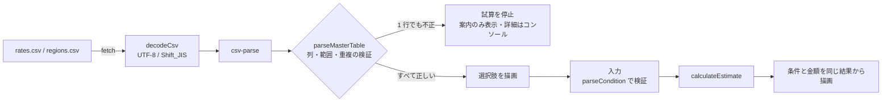

# caresend-calculator-example

CSV で管理する料金表を検証してから計算に渡す、派遣料金シミュレーターの公開用サンプルです。

自主制作サイトで実装した機能から、公開用に切り出し・調整したサンプルです。サイト全体のソースコードや共通の開発基盤は含みません。計算と料金表の検証は元の実装からの抽出、画面は公開用に作り直した最小構成です（詳しくは「[元の実装との関係](#元の実装との関係)」）。

- 元の公開サイト（架空の介護派遣会社「CareSend」）: https://caresend.preview-dev.website/
- 制作実績（foriio）: https://www.foriio.com/tzk

> 同梱の単価・地域の割合はデモ用の仮データです。実際の料金を示すものではありません。

## 担当範囲

元サイトのデザインは他社によるもので、私はデザイン制作を担当していません。担当したのはコーディングと実装で、このサンプルに含まれる範囲は次のとおりです。

- 料金表 CSV の検証（列・値の範囲・ID の重複・不正な書き方の検出）
- 試算の計算処理（地域の割合、端数処理、消費税）
- ステップ式の入力画面の制御（入力検証、ステップの切替、アクセシビリティ対応）
- 上記のテスト

このサンプルの画面スタイルは公開用に用意した簡素なもので、元サイトのデザインではありません。

## このサンプルで見てほしいこと

料金表を CSV にしたのは、納品後にクライアントがコードを触らずに単価の改定や職種の追加をできるようにするためです。その分、CSV の入力ミスで誤った金額が表示される危険があるため、次の設計にしています。

- **1 行でも不正なら料金表全体を使わない。** 一部の行だけを除いて計算を続けると、「それらしいが誤った金額」が出てしまうためです。閲覧者には「試算をご利用いただけません」とだけ表示し、更新担当者向けの詳細（行番号と理由）はコンソールに出します。
- **計算・検証と画面制御を分ける。** `calc.ts` と `rates.ts` は DOM に依存しない関数だけで構成し、単価や上限値の変更・境界値をユニットテストで確認できるようにしています。
- **表示する条件と金額を 1 つの試算結果から描画する。** 結果画面の条件欄と金額は、計算関数が返した同じオブジェクトから描画します。入力欄を別に読み直さないので、条件と金額が食い違いません。
- **非表示の行も検証する。** `enabled=0` の行に不備があっても不採用にします。表示に戻したときに初めて壊れる、という事態を防ぐためです。

### クラス名の付け方

スタイルは FLOCSS の層（Foundation / Layout / Component / Project / Utility）に分け、クラス名の接頭辞で層が分かるようにしています（`l-` `c-` `p-` `u-`）。JavaScript が要素を探すときは `js-` で始まるクラスと `data-*` 属性を使い、`l-` `c-` `p-` `u-` のクラスには触れません。状態の変化は `is-error`・`aria-current`・`hidden` で表し、見た目の切り替えは CSS 側に置いています。そのため、デザインを変えても TypeScript とテストは変更せずに済みます。

文字サイズと余白は、`foundation/_variables.scss` の `rem()` で px の値を rem に変換して書いています（`rem(14)` = `0.875rem`）。ブラウザの文字サイズ設定を変えたときに、文字と余白が一緒に拡大されるようにするためです。

## 使用技術・実行環境

| 用途 | 使用しているもの |
| --- | --- |
| 言語 | TypeScript 5.9 |
| 開発サーバー・ビルド | Vite 7 |
| スタイル | Sass（SCSS）、FLOCSS の命名・層構成 |
| CSV の解析 | csv-parse 7（ブラウザ用ビルド） |
| テスト | Vitest 4、jsdom 27（画面テスト） |
| 実行環境 | Node.js 22.23.4 以上（22 系）・24.22.1 以上（24 系）・26.12.1 以上、npm。Volta を使う場合は 24.22.1 に固定されます |

フレームワーク・CMS・データベース・外部 API は使っていません。

## 構成

```
.
├── index.html              # 画面のマークアップ（2 ステップ＋試算結果）
├── public/data/
│   ├── rates.csv           # 職種と時間単価（デモ用の仮データ）
│   └── regions.csv         # 派遣地域と単価に掛ける割合（デモ用の仮データ）
├── src/
│   ├── main.ts             # エントリー
│   ├── styles/             # SCSS（FLOCSS）
│   │   ├── main.scss       # 層の順に読み込むエントリー
│   │   ├── foundation/     # 値（_variables）と要素の土台（_base）
│   │   ├── layout/         # l-container
│   │   ├── component/      # c-button / c-form-field
│   │   ├── project/        # p-intro / p-simulator
│   │   └── utility/        # u-visually-hidden
│   └── simulator/
│       ├── rates.ts        # CSV の取得・文字コード判定・検証
│       ├── calc.ts         # 入力値の検証と料金の計算（純粋関数）
│       └── ui.ts           # ステップの切替・エラー表示・結果の描画
└── tests/
    ├── rates.test.ts       # CSV の検証
    ├── calc.test.ts        # 入力値の境界と計算・端数処理
    └── ui.test.ts          # 画面の代表的な操作（jsdom）
```

読み始めるなら `src/simulator/rates.ts` → `src/simulator/calc.ts` → `src/simulator/ui.ts` の順がおすすめです。

## データの流れ



## 計算の仕様

```
時間単価   = 職種の hourly_rate × 地域の rate_percent ÷ 100（1 円未満は四捨五入）
小計（税抜） = 時間単価 × 1 日の稼働時間 × 月の稼働日数 × 人数
消費税     = 小計 × 10%（1 円未満は切り捨て）
月額（税込） = 小計 + 消費税
```

| 入力 | 範囲 |
| --- | --- |
| 人数 | 1〜20 人 |
| 1 日の稼働時間 | 1〜12 時間 |
| 月の稼働日数 | 1〜23 日 |

入力は半角の整数のみ受け付けます。全角数字は半角として扱い、空欄・小数・負数・文字・先頭の 0（「020」など）・範囲外は、理由つきのエラーにします。範囲は `calc.ts` の `LIMITS` にまとめ、画面の案内文も同じ値から作っています。

単価は選択肢にも結果にも表示しません。一覧で単価が見えると閲覧者が料金表を逆算できてしまうため、という元サイトの方針を引き継いでいます。

## CSV の仕様

1 行目は列名です。列の並び順は入れ替えても動きます。2 つの CSV は値の列だけが異なります。

| 列名 | 内容 | 書き方 |
| --- | --- | --- |
| `id` | 識別子 | 半角英小文字・数字・ハイフン。重複不可 |
| `label` | 画面に出す名前 | 空欄不可 |
| `hourly_rate`（職種） | 時間単価（円・税抜） | 1〜99,999 の整数。`2,400` や全角数字も可 |
| `rate_percent`（地域） | 単価に掛ける割合（%） | 50〜300 の整数。標準は 100 |
| `sort_order` | 表示順 | 整数。小さいほど上 |
| `enabled` | 表示する / しない | `1` / `0`（`true` / `false` も可） |

Excel の「CSV UTF-8」「CSV（コンマ区切り）」のどちらで保存しても読み込めます（UTF-8 として読めなければ Shift_JIS として読み直します）。

CSV はブラウザから直接取得するため、閲覧者も中身を見られます。公開してよい情報だけを書く前提です。

## 起動・テスト・ビルド

対応する Node.js のバージョンは、2026 年 10 月 21 日のセキュリティリリースで修正された版以上にしています（`package.json` の `engines`）。

```bash
npm ci          # 依存のインストール（package-lock.json どおり）
npm run dev     # 開発サーバー（http://localhost:5173/）
npm test        # テスト（Vitest）
npm run build   # 型チェック＋ビルド（dist/ に出力）
npm run preview # ビルド結果の確認
```

CSV は `fetch` で読み込むため、`index.html` をファイルとして直接開くと動きません。開発サーバーかプレビューで確認してください。

## 元の実装との関係

| ファイル | 扱い | 内容 |
| --- | --- | --- |
| `src/simulator/calc.ts` | 抽出 | 元の実装と同じです。変更はコメント内のファイル名だけです |
| `src/simulator/rates.ts` | 抽出・一部変更 | 検証の規則（列・範囲・重複・`enabled`）と文字コード判定は元の実装と同じです。CSV の解析を csv-parse に置き換え、エラーの行番号は csv-parse が返す実際の行を使うようにしました（途中に空行がある場合も正しい行を指します） |
| `src/simulator/ui.ts` | 再実装 | 元の画面制御を参考に、公開用に作り直しました。下記の違いがあります |
| `index.html` / `src/styles/` | 新規 | 公開用の簡素なマークアップとスタイルです。元サイトのデザインと、普段の制作で使っている共通の SCSS（変数・mixin など）は含まず、このサンプル用に書き下ろしました |
| `tests/calc.test.ts` | 抽出 | 元のテストのうち、計算と入力値の部分です |
| `tests/rates.test.ts` | 抽出・一部変更 | 元のテストのうち、料金表の検証の部分です。CSV の書き方に関するテストは csv-parse への置き換えに合わせて書き直しました |
| `tests/ui.test.ts` | 新規 | 画面の代表的な操作を確認するテストです |
| `public/data/*.csv` | 変更 | 職種名・地域名は元と同じで、単価と割合をデモ用の仮の値にしました |

ディレクトリ構成とファイルの分け方は、このサンプルに合わせて用意したものです。元サイトや普段の制作環境の構成とは異なります。

画面の主な違いは次のとおりです。

- **元サイト:** 3 ステップ（派遣条件 → 稼働時間 → お客様情報）。お客様情報を送信し、送信が成功してから試算結果を表示します。
- **このサンプル:** 2 ステップ（派遣条件 → 稼働時間）のあとにすぐ試算結果を表示します。個人情報の入力・送信の部分は含みません。
- 元サイトでは人数・時間・日数を選択式にしていますが、このサンプルでは入力値の検証を確認しやすいように自由入力にしています。

## 確認済みの内容と未確認の事項

確認済み（2026 年 10 月 30 日）:

- `npm ci` → `npm test` → `npm run build` が、`node_modules` のない状態から成功すること（Node.js 24.22.1、テスト 50 件）
- テストの内訳: CSV の検証 29 件、計算と入力値 13 件、画面操作 8 件
- Chromium（Playwright）で、条件入力から試算結果の表示までを手動で確認

未確認:

- Safari・Firefox・実機のスマートフォンでの表示と操作
- スクリーンリーダーでの読み上げ（`aria-current`・`aria-live`・`aria-invalid` の設定はテストで確認していますが、実際の読み上げは確認していません）
- Excel で保存した実際の Shift_JIS ファイルの読み込み（テストではバイト列で確認しています）

## 公開していない部分

元サイトのうち、次の部分はこのサンプルに含めていません。

- お客様情報の送信フォームと、その受け取り側の処理
- サイト全体の構成、共通の開発基盤、ビルド・納品の仕組み
- 元の実装で使っている自作の CSV 解析処理（このサンプルでは csv-parse に置き換えています）

## 著作権・ライセンス

- Copyright (c) 2026 tzk-s. All rights reserved.
- このリポジトリはポートフォリオとして公開しているもので、オープンソースライセンスは付与していません。閲覧・評価目的以外の利用（複製・改変・再配布・他の制作物への組み込み）は許可していません。
- 依存ライブラリはそれぞれのライセンスに従います（`package-lock.json` 参照）。リポジトリにはライブラリ本体を含めていません。
- 画像・フォント・元サイトのデザイン素材は含めていません。
